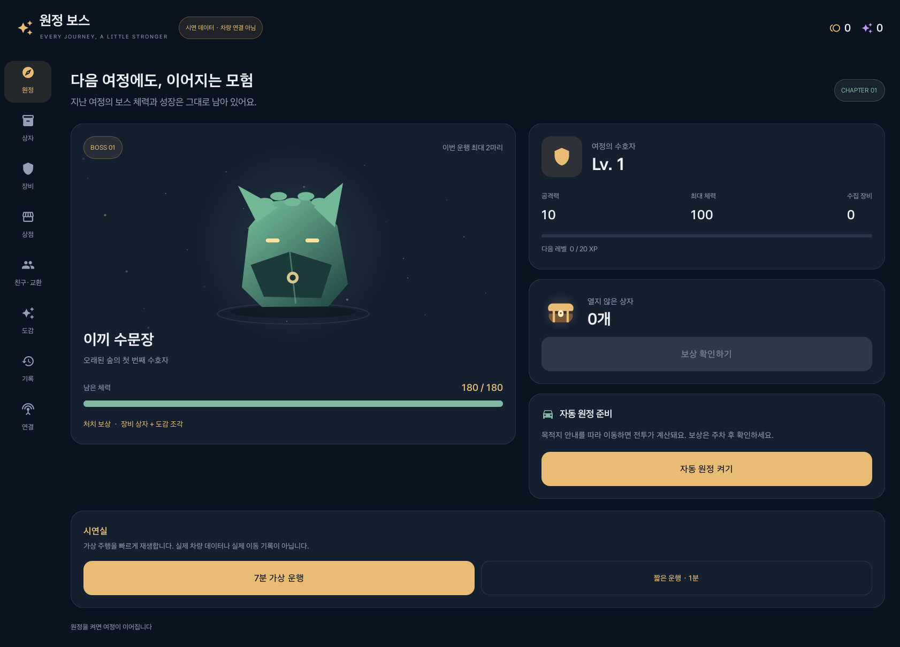
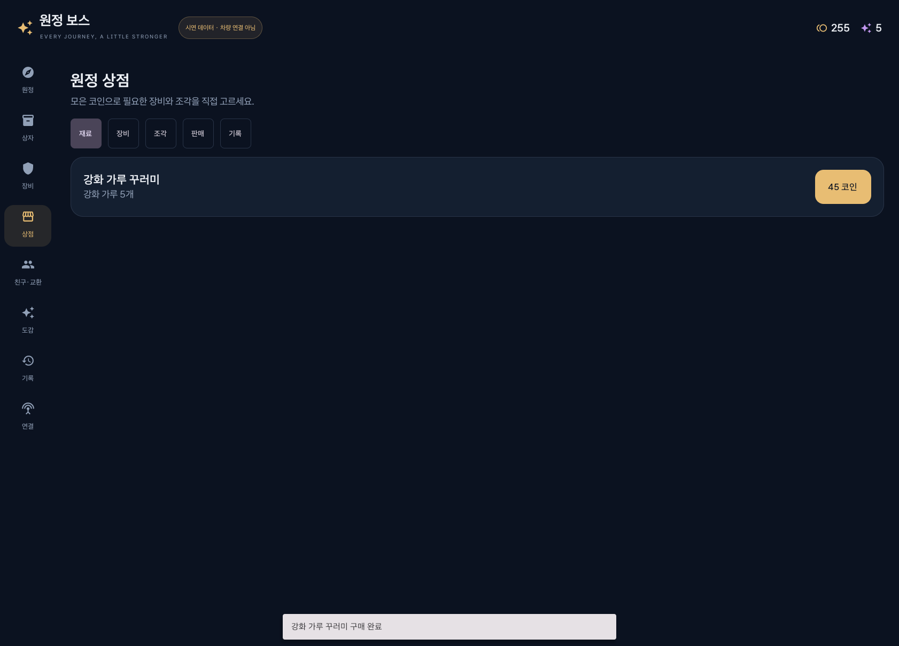
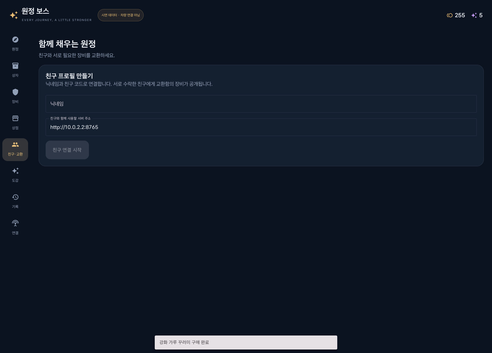
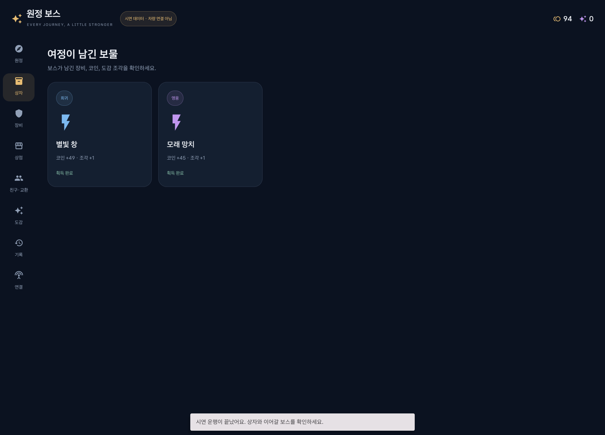
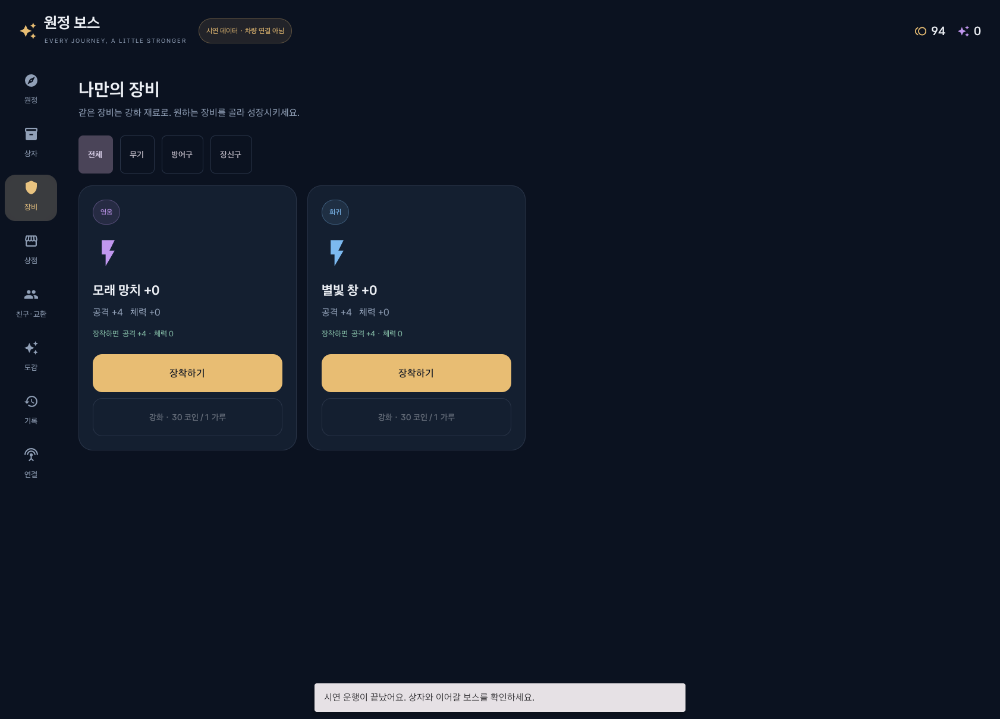
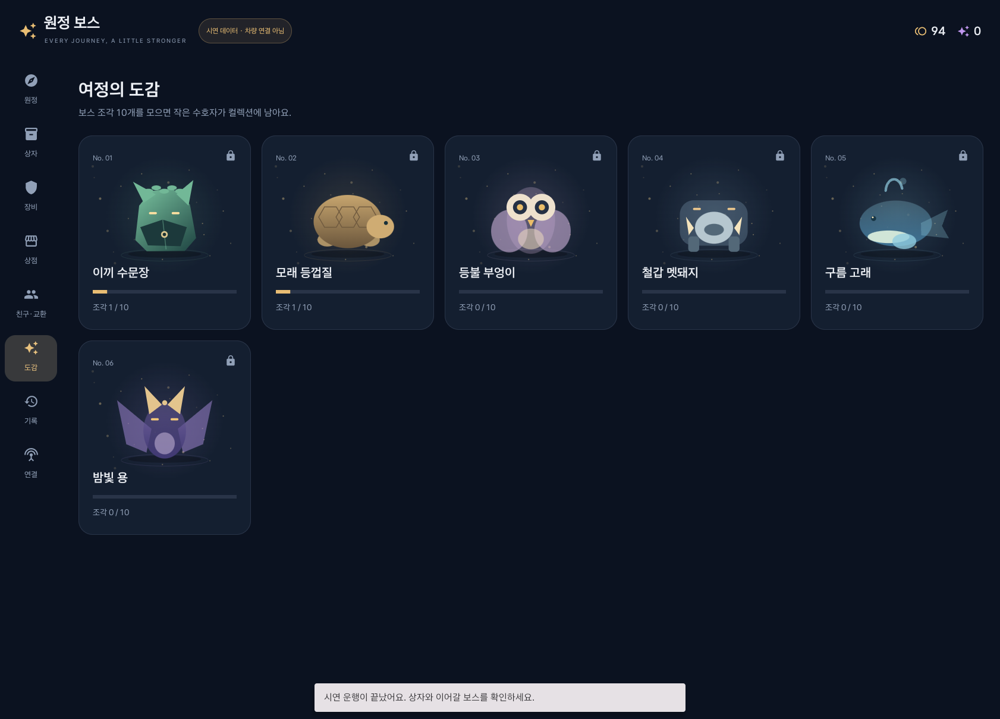
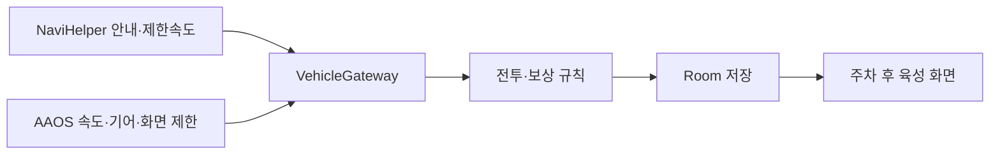

# 원정 보스 · Expedition Boss

**순정 내비를 이용한 이동을 자동 원정으로 기록하고, 주차 후 보스 보상·장비·도감을 모으는 방치형 육성 게임.**

현대자동차그룹 차량용 앱 개발 공모전을 준비하는 Pleos/Android Automotive 프로토타입이다. 주행 중에는 게임 조작 화면을 잠그고, 도착 후 육성의 재미를 제공한다. 게임은 별도 앱으로 실행된다.

**[Windows 시연 ZIP 다운로드](https://github.com/Daeho-AI/pleos-expedition-boss/releases/download/v0.2.0-preview.1/ExpeditionBoss-Windows-Demo.zip)** · **[전체 다운로드 / Release](https://github.com/Daeho-AI/pleos-expedition-boss/releases/tag/v0.2.0-preview.1)** · **[SDK 검증 기록](docs/validation/SDK_VALIDATION.md)**



## 0.2.0 — 상점과 친구·교환

- **상점:** 확정 장비, 강화 가루, 도감 조각을 게임 코인으로 구매한다. 장비 판매와 거래 내역도 제공한다.
- **친구:** 닉네임·친구 코드, 요청·수락·거절·취소, 친구 목록·삭제를 지원한다.
- **교환함:** 장착하지 않은 장비를 맡기고 친구에게 공개한다. 장비의 등급과 강화 수치를 유지한다.
- **교환:** 두 장비를 선택해 제안하고 상대가 수락하면 함께 소유권이 바뀐다. 거절·취소·24시간 만료도 처리한다.
- **재접속:** 전송 중 끊겨도 같은 요청을 이어서 확인하고, 받은 장비가 중복 지급되지 않도록 저장한다.

상점과 친구·교환 조작은 주차 상태에서 이용한다. 현재 버전은 공식 Pleos 에뮬레이터에서 검증하는 프로토타입이다.

| 원정 상점 | 친구 연결 |
|---|---|
|  |  |

## 설치하고 실행하기

### Windows에서 게임 체험

**준비:** Windows 10/11 x64, [Python 3.11 이상](https://www.python.org/downloads/windows/), 인터넷 연결, 하드웨어 가상화와 Android 에뮬레이터 실행 환경. 메모리 16GB, D드라이브 여유 공간 50GB 이상을 권장한다. 공식 기기 이미지의 압축 해제 크기만 약 20GB다.

1. 위 **Windows 시연 ZIP**을 받아 `D:\Codex\ExpeditionBoss` 같은 폴더에 **압축을 모두 푼다**.
2. 최초 한 번 `setup.cmd`를 더블클릭한다. 필요한 JDK·Android 도구·공식 Pleos 에뮬레이터 이미지와 친구 서버를 준비하고 게임을 연다. 기존 도구는 재사용한다.
3. 다음부터는 `demo.cmd`를 더블클릭한다. 친구 서버도 PC에서 자동으로 켜진다. 꺼진 기기를 준비하는 데 약 1~2분이 걸릴 수 있다.
4. 게임의 **시연실 → 7분 가상 운행**을 누른다. 7분 분량의 데이터를 몇 초 동안 재생한다.
5. **상자 → 장비 → 도감**에서 보상을 열고 육성을 진행한다. 처음 시작한 저장 데이터에서는 첫 가상 운행으로 보스 2마리를 처치한다.

ZIP에는 시연 APK가 포함된다. Git으로 소스를 받은 경우에도 `setup.cmd`가 같은 APK를 Releases에서 내려받아 SHA-256을 확인한다. APK는 Windows 실행 파일이 아니므로 APK만 더블클릭하면 게임이 열리지 않는다.

자동 설치는 D드라이브를 사용한다. 개발 도구는 `D:\Codex\PleosBossToolchain`, 가상 기기는 `D:\Codex\PleosBossEmulator`, 임시 파일은 `D:\Codex\.tmp`에 둔다. 시스템 PATH나 Windows DNS 설정은 바꾸지 않는다. 도구는 공식 배포처에서 내려받으며 Android SDK 설치 시 [SDK 이용약관](https://developer.android.com/studio/terms)에 대한 동의 응답을 전달한다.

오류가 나면 [설치 문제 해결](docs/INSTALL.md)을 확인한다. 실행 기록은 저장소의 `work/launcher-last.log`에 남는다.

### 이미 Pleos 기기가 준비된 개발자

| 파일 | 용도 | 설치 ID |
|---|---|---|
| [Daeho-AI_ExpeditionBoss_release.apk](apk/Daeho-AI_ExpeditionBoss_release.apk) | 실제 SDK 사용, 서명된 release 빌드 | `dev.pleos.entry.boss` |
| [boss-fixture-debug.apk](https://github.com/Daeho-AI/pleos-expedition-boss/releases/download/v0.2.0-preview.1/boss-fixture-debug.apk) | 게임 체험, 가상 운행 버튼 제공 | `dev.pleos.entry.boss.fixture` |
| [boss-pleos-debug.apk](https://github.com/Daeho-AI/pleos-expedition-boss/releases/download/v0.2.0-preview.1/boss-pleos-debug.apk) | SDK 진단·개발 도구용 | `dev.pleos.entry.boss` |

시연과 SDK 앱의 저장 공간은 분리된다. SDK debug와 release는 서명이 달라 서로 덮어쓸 수 없다. 새 테스트 기기를 사용한다. 서명키는 저장소에 포함하지 않는다. `release`는 빌드 종류이며 상용 출시 승인을 뜻하지 않는다.

```powershell
# 연결된 공식 Pleos/AAOS 테스트 기기에 설치
adb install -r .\apk\Daeho-AI_ExpeditionBoss_release.apk
```

주차 상태에서 **차량 데이터 권한 확인**을 누르고 필요한 권한을 허용한 뒤 자동 원정을 켠다. 에뮬레이터의 차량 데이터 시험에는 [공식 Virtual Console](https://document.pleos.ai/en/docs/connect/guide/getting-started/application-development/use-vehicle-emulator)의 활성 세션이 필요하다. 게임 체험에는 fixture APK를 선택한다.

## 친구와 교환하는 순서

1. 두 사용자 모두 **같은 서버 주소**에 연결하고 각자의 닉네임을 만든다.
2. **친구·교환 → 친구**에서 코드를 보내고, 받은 사람이 수락한다.
3. **교환함**에 서로 교환할 장비를 맡긴다. 장착 중이면 먼저 장착을 해제한다.
4. **교환**에서 친구, 내가 줄 장비, 받을 장비를 고르고 제안한다.
5. 상대가 내용을 확인하고 수락하면 교환함의 소유권이 동시에 바뀐다.
6. 각자 **교환함 → 가방으로 받기**로 가져와 장착한다.

시연 서버는 PC에서 실행하며 앱의 기본 주소는 `http://10.0.2.2:8765`다. 같은 PC의 에뮬레이터에서 사용할 수 있다. 다른 PC·차량과 인터넷으로 연결하려면 포함된 서버를 HTTPS 주소에 배포해야 한다. 외부 호스팅 계정이나 유료 서버를 자동으로 만들지는 않는다. [서버 연결·배포 안내](server/README.md)를 참고한다.

같은 장비를 받으면 높은 강화 수치를 유지하고 중복분은 강화 가루가 된다. 제안자의 장비는 수락·취소·거절·만료 때까지 교환함에 묶인다. 상대 장비가 다른 교환으로 이동하면 관련 제안은 취소된다.

## 방치형 육성의 흐름

- **6종 보스**를 순서대로 만난다. 한 여정에서 최대 2마리이며, 남은 보스 체력은 다음 여정으로 이어진다.
- 처치하면 경험치와 상자를 받는다. **장비 12종 × 4등급**, 무기·방어구·장신구 3슬롯을 조합한다.
- 중복 장비는 강화 가루가 된다. 코인과 가루로 **+10까지 강화**, 캐릭터는 **20레벨**까지 성장한다.
- 일반 상자 9회 연속 다음에는 희귀 이상이 나온다. 보스별 조각 10개로 도감 미니어처를 해금한다.
- 같은 상자·강화 요청을 반복해도 중복 지급·결제하지 않도록 저장한다. 종료 후에도 보상과 성장 상태가 유지된다.

| 보상 | 장비 | 도감 |
|---|---|---|
|  |  |  |

유효한 안내·이동·제한속도가 모두 있어야 전투가 진행된다. 제한속도 이내에서는 주행 속도와 무관하게 같은 초당 피해를 주며, 과속 중에는 공격이 멈춘다. 일정 시간 큰 폭으로 초과하면 반격이 적용된다. 정차·후진·데이터 단절·앱 종료 시간은 전투 보상으로 환산하지 않는다. 장비 변경과 상자 개봉은 **P 기어 + UX 제한 해제**를 확인한 뒤에만 가능하다.

## 사용하는 SDK와 실제 데이터

| 데이터 | API | 게임에서의 역할 |
|---|---|---|
| 순정 내비 안내 상태 | NaviHelper 3.0.5 `getRouteStateInfo()` / `onRouteStateInfo()` | 새 응답의 `naviMode == ROUTE_GUIDING`으로 여정 조건 판정 |
| 도로 제한속도 | NaviHelper `onCurrentRoadSpeedLimit(Int)` | 양수일 때만 인정, 3초 만료 |
| 차량 속도 | AAOS `CarPropertyManager` / `PERF_VEHICLE_SPEED` | m/s를 km/h로 변환, 2초 만료 |
| 기어 | AAOS `GEAR_SELECTION` | 주차 여부 확인, 읽기 전용 |
| 운전자 화면 제한 | `CarUxRestrictionsManager` | 주행 중 게임 조작 화면 차단 |

Pleos 전용 SDK는 **NaviHelper**를 사용한다. 속도·기어는 AAOS 공개 차량 API를 사용한다. 조명·차량 속도·기어 제어, 경로 쓰기, 순정 지도 오버레이는 사용하지 않는다.

상점은 게임에서 획득한 코인만 사용하며 현금 결제·광고는 없다. 게임 진행은 기기 내부 Room DB에, 친구 프로필과 교환함은 선택한 친구 서버에 저장된다. 친구 서버로 보내는 정보는 닉네임·친구 관계·맡긴 장비·교환 내역이다. 차량 속도·좌표·이동 경로는 보내지 않는다.



## 빌드와 테스트

검증 환경: **Pleos Connect Emulator 2.1.0 / API 34 / x86_64 / RAM 4GB / Cold boot**. 앱 설정은 minSdk 33, compile·targetSdk 35다. JDK 17, Gradle 8.10.2, AGP 8.8.0, Kotlin 1.9.22를 사용한다.

```powershell
git clone https://github.com/Daeho-AI/pleos-expedition-boss.git D:\Codex\ExpeditionBoss
cd D:\Codex\ExpeditionBoss

# 도구 준비. --pleos-image를 생략하면 기기 이미지를 받지 않는다.
python .\tools\bootstrap_android.py --pleos-image

# 전투 규칙 테스트 + 시연/SDK debug APK
powershell -ExecutionPolicy Bypass -File .\tools\build.ps1
powershell -ExecutionPolicy Bypass -File .\tools\package.ps1

# 자신의 로컬 키로 release 빌드
python .\tools\prepare_release_signing.py
powershell -ExecutionPolicy Bypass -File .\tools\build_release.ps1
```

전투·보상·상점 규칙, Android 저장·화면, 두 사용자 교환과 서버 동시 처리 검증은 [업데이트 검증 기록](docs/validation/UPGRADE_0_2.md)에 정리했다. 차량 API 연결 기록은 [SDK 검증 기록](docs/validation/SDK_VALIDATION.md)에 있다. SDK 다운로드·저장소 접근 조건이 변경되면 [Pleos 개발자 사이트](https://developers.pleos.ai/playground?locale=ko-KR)의 현재 안내를 따른다.

| 소스 | 역할 |
|---|---|
| `android/core-game` | 전투·보상·장비 규칙과 단위 테스트 |
| `android/app-boss/src/main/java/dev/pleos/entry/boss/sdk` | 실제 SDK / 명시적 가상 입력 |
| `android/app-boss/src/main/java/dev/pleos/entry/boss/data` | Room 저장과 중복 요청 처리 |
| `android/app-boss/src/main/java/dev/pleos/entry/boss/ui` | 원정·상자·장비·상점·친구·도감·연결 화면 |
| `android/app-boss/src/main/java/dev/pleos/entry/boss/social` | 친구 서버 통신과 장비 전송·수령 복구 |
| `android/app-boss/src/main/assets/balance.json` | 게임 수치 |
| `tools` | Windows 설치·실행·빌드·검증 |
| `server` | 친구 관계·교환함·원자적 교환을 처리하는 Python/SQLite 서버 |

## 현대 공모전 기준과의 연결

공식 [제출 안내](https://appdevchallenge.auto-hmg.io/guide/submission)가 요구하는 **앱 이름·한 줄 소개, 실행 방법, 테스트 환경·설정, APK 위치**를 정리했다. 소스와 서명된 release APK를 함께 제공하며, [심사 기준](https://appdevchallenge.auto-hmg.io/guide/judging-awards)의 차량특화성·창의성·기술 활용성·사업성에 대한 설명은 [공모전 대응 문서](docs/CONTEST.md)에 있다.

주행 중 상점·교환을 포함한 게임 조작 화면은 기어와 `CarUxRestrictions`에 따라 제한한다. 검증 환경과 실행 방법을 함께 제공한다.

이 저장소 공개는 공모전 접수나 앱 마켓 등록 자체를 대신하지 않는다. 외부 구성요소는 [THIRD_PARTY_NOTICES.md](THIRD_PARTY_NOTICES.md)를 참조한다.
