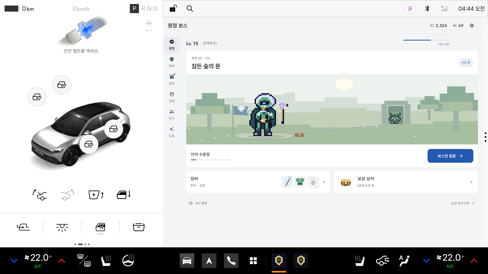
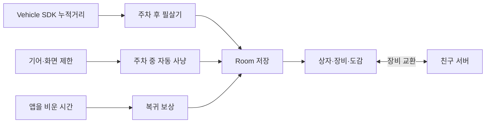

# 원정 보스

**평소의 주행거리를 보스에게 날리는 필살기로 바꾸고, 주차·충전 대기 중에는 사냥과 장비 수집을 즐기는 차량용 방치형 RPG입니다.**

[**▶ 시연 영상 보기**](https://daeho-ai.github.io/pleos-expedition-boss/) · [**APK 다운로드**](https://github.com/Daeho-AI/pleos-expedition-boss/raw/refs/heads/main/apk/모아_원정보스_release.apk) · [**Windows에서 체험하기**](https://github.com/Daeho-AI/pleos-expedition-boss/releases/download/submission/ExpeditionBoss-Windows-Demo.zip)

[](https://daeho-ai.github.io/pleos-expedition-boss/)

## 주요 기능

- **주행거리 필살기:** 이동 전후의 차량 누적거리를 비교해, 주차 후 보스에게 강력한 일격을 날립니다. 주행 속도는 보상에 영향을 주지 않습니다.
- **주행 중 게임 중단:** 출발하면 게임 화면과 소리를 끄고 전투를 멈춥니다. 주차 후 앱으로 돌아오면 비운 시간의 보상을 받고 자동 사냥을 이어갑니다.
- **보스 사냥과 장비 성장:** 보스를 처치해 상자를 열고 장비를 모읍니다. 장착·강화에 따라 캐릭터 외형과 공격력이 바뀌며, 처치한 보스는 도감에서 확인합니다.
- **상점:** 게임에서 모은 코인으로 장비, 강화 재료와 도감 조각을 삽니다.
- **친구 교환:** 서로 필요한 장비를 제안하고, 상대가 내용을 확인해 수락하면 교환합니다.

자동 사냥과 게임 조작은 **P 기어이고 화면 사용이 허용된 상태에서 앱을 열었을 때** 가능합니다. 충전 중 이용도 이 주차 조건을 따릅니다.

## SDK와 기술 구조

| 구성 | 사용하는 기능 | 앱에서 하는 일 |
|---|---|---|
| **Pleos Vehicle SDK 2.3.2** | `getOdometer()` → 지원 여부 확인 → `getCurrentDistanceDriven()` | 주차 중 누적 주행거리(km)를 읽고, 이동 전후의 차이를 필살기 피해량으로 바꿉니다. |
| **Android Automotive** | `GEAR_SELECTION`, `CarUxRestrictionsManager` | 주차 여부와 화면 사용 제한을 확인합니다. 주행하거나 상태를 확인할 수 없으면 게임을 중단합니다. |
| **Pleos NaviHelper 3.0.5** | `getRouteStateInfo()`, `onRouteStateInfo()` | 설정의 차량 연결 화면에서 순정 내비 안내 상태를 확인합니다. |
| **Kotlin·Compose / Room** | 게임 화면, 기기 내 저장 | 자동 사냥·장비·보상을 처리하고, 정산한 시간과 거리를 함께 저장해 중복 지급을 막습니다. |
| **Python·SQLite 서버** | 친구 관계, 교환함, 교환 수락 | 두 사용자의 동의를 확인하고 장비 소유권을 함께 변경합니다. |



차량 데이터는 읽기만 합니다. 게임을 비운 동안에는 전투를 실행하지 않고, 돌아왔을 때 최대 8시간의 보상을 계산합니다. 주행거리 보너스는 한 번에 최대 30km, 현재 보스의 남은 체력까지 적용합니다. 내비 안내 여부는 보상 조건에 포함하지 않습니다.

차량의 좌표·이동 경로를 수집하지 않으며, 누적거리도 친구 서버로 보내지 않습니다. 친구 서버에는 닉네임, 친구 관계, 교환할 장비와 교환 내역을 저장합니다.

## 실행 방법

### Windows에서 체험

1. [시연 ZIP](https://github.com/Daeho-AI/pleos-expedition-boss/releases/download/submission/ExpeditionBoss-Windows-Demo.zip)을 받아 `D:\Codex\ExpeditionBoss`에 압축을 풉니다.
2. Python 3.11 이상을 설치한 뒤 `setup.cmd`를 실행합니다. Pleos 에뮬레이터와 필요한 도구를 준비하고 게임을 엽니다.
3. 다음부터는 `demo.cmd`로 실행합니다. 친구 서버도 PC에서 함께 실행됩니다.
4. 게임의 **설정 → 7분 · 10 km 이동 시연**에서 주행 중 중단, 복귀 보상과 필살기를 체험합니다. 이 버튼의 시간·거리는 가상 입력입니다.

Windows 10/11 x64, 하드웨어 가상화, 인터넷 연결이 필요합니다. 메모리 16GB와 D드라이브 여유 공간 50GB 이상을 권장합니다. [자세한 설치 안내](docs/INSTALL.md)

### Pleos 에뮬레이터에 직접 설치

[apk/모아_원정보스_release.apk](apk/모아_원정보스_release.apk)는 실제 Pleos SDK를 사용하는 서명된 설치 파일입니다.

```powershell
adb install -r .\apk\모아_원정보스_release.apk
```

주차 상태에서 앱을 열고 **차량 데이터 권한 확인**을 누른 뒤 **보스전 입장**을 선택합니다. **설정 → 차량 연결**에서 데이터 수신 여부를 확인할 수 있습니다. 차량 데이터 시험에는 공식 Virtual Console의 활성 세션이 필요할 수 있습니다. 일반 휴대폰에서는 Pleos SDK를 사용할 수 없습니다.

친구 교환은 두 사용자가 같은 서버에 연결해야 합니다. Windows 시연 앱은 같은 PC의 서버(`http://10.0.2.2:8765`)를 이용합니다. 제출용 release 앱에는 HTTPS 서버 주소를 입력해야 하며, 공개 운영 서버는 제공하지 않습니다. [친구 서버 실행·연결 안내](server/README.md)

## 테스트 환경

- Pleos Connect 에뮬레이터 **2.1.0**, Android 14 / API 34, x86_64
- 화면 **2560 × 1440, 160 dpi**, 가로 화면, RAM 4GB
- Windows, Cold boot, 앱 전체 창과 분할 창
- 확인한 기능: 차량 데이터 수신, 주행 중 게임 중단, 주차 후 복귀, 상자 개봉, 장비 장착·강화, 상점과 친구 교환
- 거리 보너스의 반복 시험은 가상 입력으로 수행하며 SDK 수신 시험과 구분합니다.

[차량 SDK 확인 기록](docs/validation/SDK_VALIDATION.md) · [게임 화면·기능 확인 기록](docs/validation/APP_VALIDATION.md)

## 소스 구성

```text
android/app-boss/  차량 앱 · Pleos SDK 연동 · 화면 · 저장
android/core-game/ 전투 · 보상 · 장비 · 복귀 정산 규칙
server/           친구 관계 · 교환함 · 장비 교환
apk/              제출용 release APK
tools/            설치 · 실행 · 빌드 · 검증 도구
```

[소스 빌드](docs/DEVELOPMENT.md) · [기획과 발전 계획](docs/CONTEST.md) · [외부 구성요소](THIRD_PARTY_NOTICES.md)
