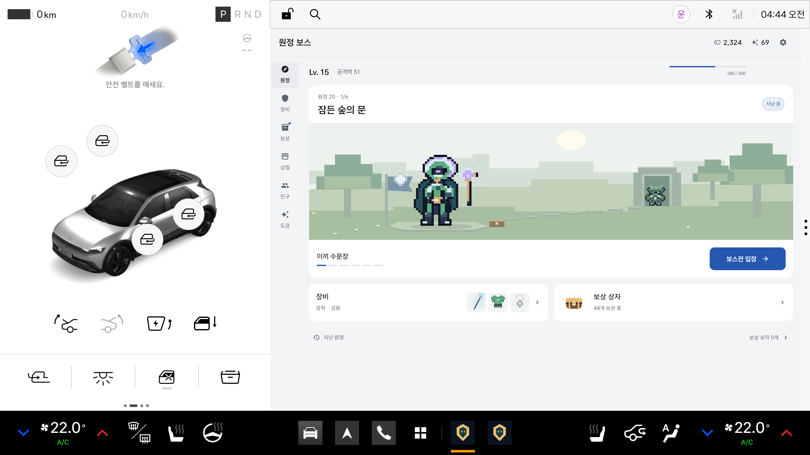
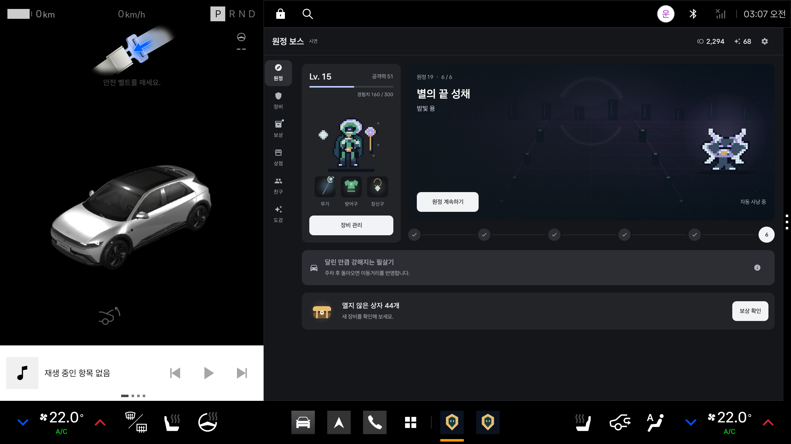
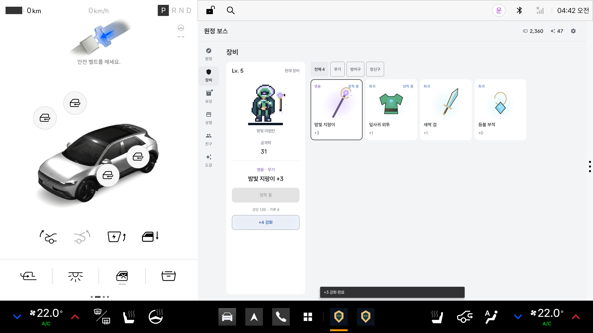
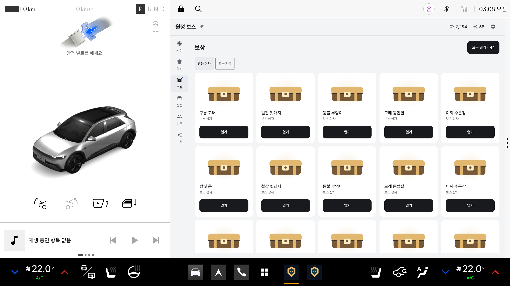
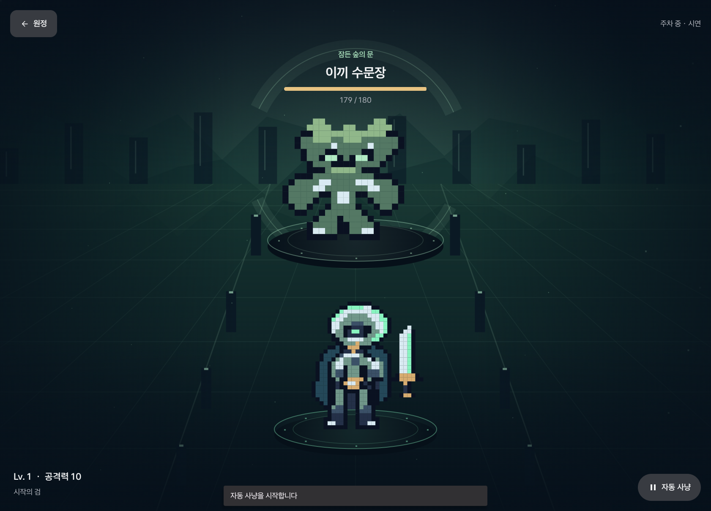

# 0.7.0 화면 구성과 검증

앱 화면에 섞여 있던 기능 소개와 연결 진단을 설정으로 옮기고, 플레이 중 확인하거나 선택할 정보 중심으로 정리했다. 주행 정지·복귀 정산·거리 일격·보상 지급·교환 처리 규칙은 그대로 사용한다. 방어구의 기본 능력치와 강화를 실제 자동 사냥 공격력에 반영하도록 밸런스를 1.1.0으로 변경했다. 기존 장비와 강화 단계는 보존된다.

## 바뀐 화면

| 화면 | 변경 |
|---|---|
| 공통 | 시스템 주간·야간 모드, 중립색 배경, 64 dp 이상 주요 조작, 짧은 한국어 메뉴 |
| 원정 | 캐릭터·장착 장비, 현재 보스, 6개 구역 진행, 이동 보너스, 받은 상자 |
| 장비 | 장착 중인 순서로 정렬, 장착 전 미리보기와 능력치 비교, 실제 밸런스 설정에서 읽은 강화 비용 |
| 보상 | 받은 상자와 획득 기록 분리, 개별·일괄 열기, 아이템 획득·중복 가루 표시 |
| 전투 | 설명용 측면 패널 제거, 보스 체력과 장비 표시, 입장·승리·보상·다음 보스 전환 유지 |
| 상점 | 아이템 그림, 가격, 레벨·보유·코인 부족 상태 |
| 친구 | 짧은 요청·교환 상태, 서버 주소는 연결 설정에서 입력 |
| 설정 | 플레이 규칙, 원정 기록, 차량 연결, fixture 시연 도구 |

장비 미리보기는 장착 버튼을 누르기 전까지 실제 장비를 변경하지 않는다. 상자 지급과 필살기 피해는 저장된 게임 상태만 사용한다. 화면 연출이 보상을 추가로 지급하지 않는다.

좁은 앱 창에서는 상단 메뉴와 장비 상세 팝업을 사용한다. 전투는 앱에 할당된 영역 전체에 표시하며 차량의 Driving view와 시스템 바를 덮지 않는다.

## 방어구 성장

기존 방어구는 체력만 올렸고 현재 자동 사냥에는 피격·생존 판정이 없어 사냥 속도에 기여하지 않았다. 방어구 4종에 기본 공격력 2·3·4·5를 부여하고 등급 배율과 단계별 강화 공격력을 적용한다. 무기와 장신구 수치는 유지한다. 장비 화면에서는 사용하지 않는 플레이어 체력을 제거하고 실제 공격력의 전후 변화를 표시한다. 과거 체력 필드는 저장 데이터 호환을 위해 유지한다.

## 참고한 공식 자료

- [Pleos UI 디자인 가이드](https://document.pleos.ai/docs/connect/guide/docs-design/Introduction/intro): 간결한 문구, 충분한 대비, 일관된 조작, 주간·야간 모드.
- [색상](https://document.pleos.ai/docs/connect/guide/docs-design/foundations/colors): 중립색 기반의 계층과 테마 구분.
- [글자](https://document.pleos.ai/en/docs/connect/guide/docs-design/foundations/typography): 중립적인 글꼴과 읽기 쉬운 크기.
- [화면 구성](https://document.pleos.ai/docs/connect/guide/docs-design/getting-started/layout): 앱 영역 안에서 동작하고 창 크기에 대응.

공식 시스템 화면을 복제하거나 현대의 심사 통과를 주장하는 것은 아니다. 기존 주행 제한 로직은 유지한다. 충전 대기는 주차 중 이용 상황이며 충전 상태 자동 감지 기능은 없다.

## 검증 자료

| 검사 | 결과 | 기록 |
|---|---|---|
| 코어 전투·보상·정산·장비 규칙 | 39개 통과, 실패 0개 | [unit-tests.json](unit-tests.json) |
| 앱 UI | 8개 통과: 전투 진입·복귀, 주행 차단·정산, 외형 미리보기·장착·강화, 상자 개봉·다음 보스, 상점 구매 | [실행 결과](instrumentation-fixture-tests-0.7.0.txt) |
| 실제 SDK 연결 | 2개 통과: 최신 주차 상태에서 전투 유지, 누적거리 조회·백그라운드 연결 해제 | [실행 결과](instrumentation-sdk-tests-0.7.0.txt) |
| release Lint | 오류 0개, 경고 18개 | [결과](lint-0.7.0.txt) |
| 테마·창 크기 | 주간·야간, 기본 1682×1210 앱 영역, 너비 840 창에서 원정·장비 상세 확인 | [창 크기 기록](layout-0.7.0.json) |
| 주요 글자 대비 | 대표 8개 색 조합 5.13:1 이상 | [계산값](contrast-0.7.0.json) |
| APK 서명 | 기존 키 유지, 서명 검증 통과, release의 debuggable=false | [파일 정보](../../apk/release-manifest.json) |

공식 Pleos Connect Emulator 2.1.0 / API 34 / x86_64 / 2560×1440 / 160dpi에서 확인했다. UI 검사는 별도 fixture 앱의 가상 입력을 사용하고, SDK 검사는 SDK 빌드와 공식 Virtual Console을 사용한다. 앱 UI 시험은 테스트 전 진행 상태를 종료 시 복원한다. 주간·야간 및 창 크기 검사도 기존 모드와 창 크기로 복원했다. 대비 수치는 대표 색 조합의 계산값이며 전체 접근성 인증을 의미하지 않는다.

처음에는 Android Emulator 37.2.13의 Windows 실행기가 그래픽 모드를 바꿔도 종료되었다. `-gpu host -feature -Vulkan` 환경으로 바꾼 뒤 정상적으로 검사를 진행했다. 실행기에 Vulkan 비활성화 옵션을 반영했다. 초기 부팅 중 차량 런처가 앱 영역을 다시 구성하면서 UI 검사 2개가 중단된 경우가 있어, 차량 화면이 준비된 뒤 전체 8개를 다시 실행해 통과를 확인했다. 이 문제와 앱의 Java 예외를 혼동하지 않도록 로그를 구분했다.

최종 설치 파일을 `tools/run_demo.ps1 -Mode fixture`의 기본 옵션으로 다시 실행해 친구 서버 준비·가상 기기 부팅·APK 설치·앱 전면 실행까지 확인했다. 초기 부팅에서는 순정 내비가 뒤늦게 나타나 게임 창을 가리는 경우도 확인했다. 실행기가 Driving view와 순정 내비의 초기 창 구성을 기다리고, 게임이 앱 영역에서 10초 동안 전면 상태를 유지하는지 확인하도록 수정했다. 새로 부팅한 기기에서 차량 영역과 게임 영역이 모두 보이고 겹치지 않는 것을 [실행기 검사](launcher-0.7.0.json)로 확인했다. 사용자용 실행 창을 남겨 두었으며 게임 데이터 초기화는 수행하지 않았다.

## 실제 화면

| 주간 원정 | 야간 원정 |
|---|---|
|  |  |

| 장비 | 보상 | 전투 |
|---|---|---|
|  |  |  |

[새 UI 미리보기](https://github.com/Daeho-AI/pleos-expedition-boss/releases/download/v0.7.0-preview.1/ExpeditionBoss-UI-Preview.mp4)는 실제 시연 앱의 화면 녹화다. 장비 미리보기·상자 개봉·상점·친구·야간 화면을 보여 주며 음성과 설명용 화면 합성은 사용하지 않았다. 1920×1080, 61.18초이며 [전체 디코딩 검사](video-0.7.0.json)와 [장면 전환 기록](video-timeline-0.7.0.json)을 남겼다. README의 기존 90초 차량 시나리오 영상은 0.6.1 화면임을 별도로 표시했다.
